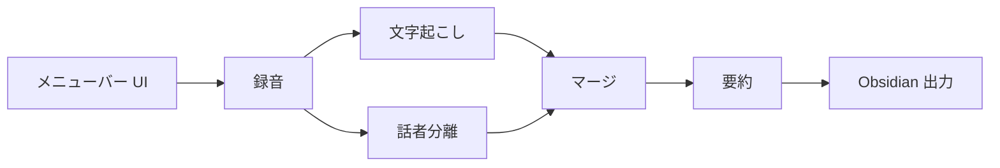

# ローカル会議録音・議事録アプリ 設計

2026-10-28 · 元ドキュメント: https://claude.ai/artifact/9PgKEH96FH8BKN54Cw4zPw

## 概要と目的

MacBook Pro（Apple Silicon）上で、会議の録音・文字起こし・話者分離・要約・Obsidianへの保存までを、すべてローカルで完結させる個人用アプリを作る。

- 音声も文字起こしも外部サービスに送らないため、社内会議や機密性の高い会話にも使える。
- 既存環境（Ollama + qwen3.5 9B）を活かし、追加コストなしで動かす。
- 会議後に議事録が自動で Obsidian に並ぶ状態をゴールとする。

## 要件

決定済みの仕様は以下のとおり。

| 項目 | 決定内容 |
| --- | --- |
| 対象 | オンライン会議（Zoom/Meet等）と対面会議の両方 |
| 処理タイミング | 会議後に一括処理（リアルタイム表示なし） |
| 文字起こし | mlx-whisper（日本語） |
| 話者分離 | 全員を区別（話者1・話者2…） |
| 要約項目 | 概要、決定事項、ToDo、議題ごとの要点 |
| 要約モデル | Ollama + qwen3.5 9B（既存環境） |
| 要約プロンプト | Markdownファイルで管理し、コード変更なしで編集できる |
| 人名・用語辞書 | 登録した表記で文字起こし・要約する |
| 過去の議事録 | 同じ会議シリーズの前回議事録を要約の文脈に使う |
| 保存先 | Obsidian Vault に Markdown |
| UI | メニューバー常駐 |
| 録音データ | 文字起こし後も残す |
| 通信 | 一切なし（モデル初回ダウンロードを除く） |

## 全体アーキテクチャ

メニューバーから録音を止めると、文字起こしから Obsidian への保存までがバックグラウンドで順に自動実行される。



文字起こしと話者分離は同じ音声を別々に処理し、その結果をタイムスタンプで突き合わせる。技術スタックは Python、sounddevice、mlx-whisper、sherpa-onnx、Ollama、rumps。

## コンポーネント設計

各処理は独立したモジュールにし、パイプラインとして順に実行する。途中の成果物はファイルに残し、どの段からでも再実行できるようにする。

### 1. 録音

- ライブラリ：sounddevice + soundfile で WAV（16kHz・モノラル）に保存。
- オンライン会議：BlackHole 2ch を入れ、macOS の「Audio MIDI 設定」で集約デバイス（マイク + BlackHole）を作って録音する。
- 対面会議：内蔵マイクをそのまま使う。
- 入力デバイスはメニューから切り替える（「オンライン」「対面」のプリセット）。

### 2. 文字起こし

- mlx-whisper、モデルは whisper-large-v3-turbo、`language="ja"` を固定。
- 出力はタイムスタンプ付きセグメント（start / end / text）。
- 繰り返しのハルシネーション対策に `condition_on_previous_text=False` を使う。

### 3. 話者分離

- sherpa-onnx の話者分離（pyannote segmentation-3.0 の ONNX 版 + 3D-Speaker の話者埋め込み + クラスタリング）を使い、話者区間（start / end / speaker）を出力。
- モデルは初回に GitHub Releases から `~/.cache/hisoka/models/` に取得する。Hugging Face のアカウントやトークンは不要。CPU（ONNX Runtime）で動かす。
- 話者数が分かっている会議では、人数を指定して精度を上げられるようにする。

### 4. マージ

- Whisper の各セグメントに、時間的に最も重なる話者を割り当てる。
- 同じ話者の連続セグメントは1つの発言にまとめる。
- 出力形式：`[00:12:34] 話者1：〜`。

### 5. 要約

- Ollama の `/api/chat` を呼び、qwen3.5 9B で要約する（思考モードはオフ）。
- システムプロンプトは Markdown ファイルで管理し、実行時に読み込む。コードを触らずに、要約の観点や出力形式を変えられる。
- プロンプトはチャンク要約用（map）と統合用（reduce）の2ファイルに分ける。
- 長い会議は文字数でチャンク分割し、チャンクごとに要約したうえで統合する2段構成（map-reduce）。
- 出力はJSON（概要・決定事項・ToDo・議題ごとの要点）で受け取り、Markdownに整形する。

### 6. Obsidian 出力

- 設定ファイルで Vault のパスとフォルダを指定する。
- frontmatter に日付・会議種別・参加人数・音声ファイルへのパスを入れる。
- 本文は要約を上に、全文の文字起こしを下に置く。

### 7. メニューバー UI

- rumps で常駐アプリにする。メニューは「録音開始/停止」「入力プリセット」「処理状況」「Vault を開く」「設定」。
- 録音停止後は、バックグラウンドで処理を順に実行し、完了時に macOS の通知を出す。
- 初版はターミナルから起動し、安定したら py2app でアプリ化する。

### 8. 人名・用語辞書

- 人名と用語を Obsidian Vault 内の Markdown（`_dictionary/people.md`、`_dictionary/terms.md`）に表で登録する。Obsidian から直接編集できる。
- 列は「表記」「読み・誤認識されやすい表記」「補足（所属や意味）」の3つ。
- 辞書は3か所で使う。
    1. 文字起こし：mlx-whisper の `initial_prompt` に表記を渡し、認識を寄せる。長さに上限（約224トークン）があるため、会議シリーズに紐づく語を優先する。
    2. 後処理：誤認識されやすい表記を、正しい表記に置換する。
    3. 要約：辞書を要約プロンプトに差し込み、人名や用語の表記を揃える。
- 人名は、話者ラベルを実名に置き換える際の候補にも使う。

### 9. 過去議事録の参照

- 会議に「シリーズ」（例：週次定例）を付け、frontmatter の `series` で管理する。録音開始時にメニューから選ぶ。
- 同じシリーズの直近の議事録から、決定事項と ToDo だけを抜き出して統合用（reduce）プロンプトに渡す。
- これで、前回 ToDo の進捗や決定事項の変更を要約に反映できる。文字起こし全文は渡さず、コンテキストを節約する。
- 新しいノートには前回ノートへのリンク（`[[...]]`）を入れる。

## データとファイル構成

会議ごとに1フォルダを作り、各段の中間成果物を残す。Obsidian には最終ノートだけを書き出す。

```
~/MeetingRecorder/
  config.toml              # Vaultパス、モデル名、プリセット等
  prompts/
    summarize_chunk.md     # チャンク要約用システムプロンプト（map）
    summarize_merge.md     # 統合用システムプロンプト（reduce）
  meetings/
    2026-10-28_1400/
      audio.wav            # 録音（保持）
      transcript.json      # Whisperセグメント
      diarization.json     # 話者区間
      merged.txt           # 話者付き文字起こし
      summary.json         # 要約（構造化）

<Obsidian Vault>/Meetings/
  _dictionary/
    people.md              # 人名辞書
    terms.md               # 用語辞書
  2026-10-28_1400 週次定例.md
```

Obsidian ノートのテンプレート：

```markdown
---
date: 2026-10-28 14:00
type: online
series: 週次定例
prev: "[[2026-10-21_1400 週次定例]]"
speakers: 3
audio: ~/MeetingRecorder/meetings/2026-10-28_1400/audio.wav
tags: [meeting]
---
# 会議メモ 2026-10-28 14:00

## 概要
## 決定事項
## ToDo
- [ ] 担当：〜 / 期限：〜
## 前回からの進捗
## 議題ごとの要点
## 文字起こし
[00:00:12] 話者1：〜
```

辞書ファイルの例（terms.md）：

```markdown
| 表記 | 読み・誤認識 | 補足 |
| --- | --- | --- |
| Redash | リダッシュ, レダッシュ | BIツール |
| povo | ポヴォ, ポボ | 通信サービス |
```

## リソースと処理時間の見積もり

各モデルは順番にロード・解放するため、同時に載るのは1つだけ。qwen3.5 9B が動く環境ならメモリは足りる見込み。

| 処理 | メモリ目安 | 60分会議の処理時間目安 |
| --- | --- | --- |
| 文字起こし（large-v3-turbo） | 実測 約1.5GB | 実測 約2分（39分の音声で134秒、約17倍速） |
| 話者分離（sherpa-onnx） | 実測 約0.8GB | 実測 約3分（39分の音声で176秒、CPU 4スレッド） |
| 要約（qwen3.5 9B） | 約6〜8GB | 数分 |

「実測」以外の数値は概算で、機種によって変わる。プロトタイプで実測して、この表を更新する。実測は Apple Silicon・メモリ24GB の MacBook Pro（2026-10-29）、初回のモデルダウンロード（文字起こし約1.6GB、話者分離約44MB）を除く。音声は16kHz・モノラルのWAVで1時間あたり約115MB。

## リスクと対策

最大のリスクは話者分離の精度で、ここは早い段階で実音声を使って検証する。

| リスク | 影響 | 対策 |
| --- | --- | --- |
| 発言の重なりや相槌で話者ラベルがずれる | 議事録の発言者が誤る | 話者数の指定、短い区間のまとめ処理、手動で修正しやすい出力形式 |
| Whisperが無音区間で同じ文を繰り返す | 文字起こしにノイズが入る | `condition_on_previous_text=False`、VADで無音区間を除外 |
| 長い会議で要約の情報が抜ける | 決定事項・ToDoの漏れ | map-reduce要約、決定事項とToDoはチャンク単位で抽出してから統合 |
| 9Bモデルの要約品質が不足する | 要約が浅くなる | プロンプト調整、必要に応じて大きいモデルへの差し替えを設定で可能にする |
| BlackHole使用時にMacの音量キーが効かない | 使い勝手の低下 | 会議時だけ出力デバイスを切り替える手順を用意する |
| py2app化でマイク権限が取れない | アプリ化で詰まる | 初版はターミナル起動、Info.plistに権限の説明文を入れる |

## 開発ステップ

リスクの高い処理部分を先に検証し、録音とUIは後から足す。

1. 録音済みの音声ファイルで文字起こしを検証する（精度と処理時間を実測）。
2. 話者分離とマージを追加し、実際の会議音声でラベルの精度を確認する。
3. 要約を追加し、プロンプトと出力形式を調整する。
4. Obsidianへの書き出しを追加し、ファイル入力からノート生成までをCLIで通す。
5. 録音機能を追加する（対面→オンラインの順）。
6. rumpsでメニューバー化し、バックグラウンド処理と完了通知を入れる。
7. py2appでアプリ化する。

## 未決事項

- [ ] 想定する会議の長さと参加人数の上限
- [ ] Obsidian の保存フォルダとファイル名の規則
- [ ] 話者ラベルを実名に置き換える方法（手動編集か、名前を入力するUIか）
- [ ] 要約プロンプトの細部（ToDoの担当者・期限が不明なときの扱い）
- [ ] 録音音声の長期保管の方針（保存場所と容量の上限）
- [ ] 過去議事録を何回分さかのぼって参照するか（初版は直前1回の想定）
- [ ] シリーズに属さない単発の会議の扱い
